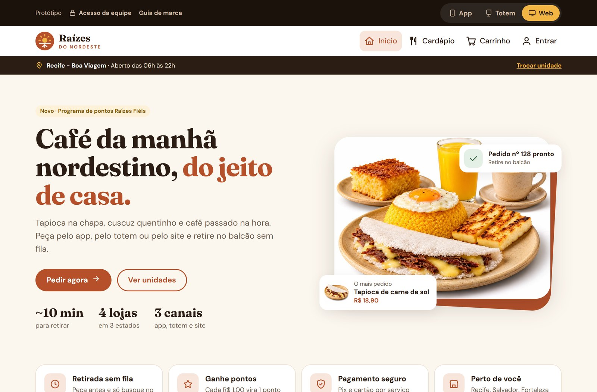

# Raízes do Nordeste - Protótipo Front-End

Projeto Multidisciplinar (Trilha Front-End) - UNINTER 2026.

Protótipo navegável do sistema de pedidos da rede de lanchonetes "Raízes do Nordeste",
feito com HTML, CSS e JavaScript puros, usando dados mockados e `localStorage` no lugar do back-end.

**Site publicado:** https://thiagomoraes97.github.io/raizes-do-nordeste/



## Como rodar

Basta publicar a pasta no GitHub Pages ou abrir com um servidor local, por exemplo:

```
python -m http.server 5500
```

Depois acesse http://localhost:5500

Usuário de teste: `maria@teste.com` / senha `123456` (começa com 150 pontos).

Equipe (link "Acesso da equipe" na barra do protótipo): `atendente`, `cozinha` ou `gerente`, todos com senha `1234`.
Atendente e cozinha só abrem o Painel da Cozinha; o Painel do Gerente exige o perfil gerente.
Logins, saídas e tentativas de acesso negado ficam registrados na auditoria.

## Modos de visualização (App, Totem e Web)

A barra escura no topo do site permite ver o protótipo como cada canal, e a troca acontece na hora:

- **App:** a tela fica com largura de celular e ganha uma barra de navegação embaixo, como um aplicativo.
- **Totem:** botões, textos e áreas de toque maiores; o pedido pode ser feito sem cadastro e,
  ao terminar ou tocar em "Recomeçar", o login e o carrinho são apagados.
- **Web:** site completo para computador.

Para o layout acompanhar a largura do modo App mesmo num computador, o CSS usa *container queries*
(`@container pagina`) na área de conteúdo, em vez de depender só da largura da janela.

## Fotos dos pratos

As fotos ficam em `img/fotos/`.
O caminho de cada foto está no campo `foto` dos produtos, em `js/dados.js`.

## Identidade visual e design system

- **Logo:** o sol do sertão nascendo sobre a terra, com raízes por baixo (`img/logo.svg`).
- **Cores:** Terracota `#B5502A`, Sol `#F2B544`, Mandacaru `#3E6B48`, Café `#2B1D14` e Areia `#FBF6EE`.
- **Tipografia:** Fraunces (títulos) e DM Sans (textos), via Google Fonts.
- **Componentes:** botões, campos, cartões de opção, selos, mensagens, chips, cartão de produto,
  linha do tempo do pedido e ícones. Todos estão documentados em `design-system.html`.
- **Fotografia:** fotos de estúdio com fundo branco, prato de cerâmica bege e luz vinda da esquerda (`img/fotos/`).
- Os valores da marca ficam como variáveis CSS no início de `css/style.css`.

## Telas

| Arquivo | Tela | Ator |
|---|---|---|
| index.html | Escolha do canal (App, Totem, Web) e da unidade, promoções | Cliente |
| cardapio.html | Cardápio da unidade, filtro por categoria, produtos juninos | Cliente |
| carrinho.html | Itens, tipo de pedido, cupom e uso de pontos | Cliente |
| pagamento.html | Envio do pagamento ao serviço externo (simulado) | Cliente / Gateway |
| pedido.html | Acompanhamento do status do pedido | Cliente |
| login.html / cadastro.html | Autenticação e cadastro com consentimento | Cliente |
| conta.html | Fidelidade, histórico, dados pessoais e direitos LGPD | Cliente |
| privacidade.html | Política de Privacidade | Cliente |
| equipe.html | Login da equipe com controle de acesso por perfil | Atendente / Cozinha / Gerente |
| cozinha.html | Fila de pedidos, mudança de status e cancelamento | Atendente / Cozinha |
| gerente.html | Relatórios por unidade, região, canal, produtos e auditoria | Gerente |
| design-system.html | Guia de marca e componentes visuais | Equipe |

## Regras implementadas

- Cada unidade tem seu próprio cardápio; o formato reduzido (Caruaru) tem menos itens.
- Produtos juninos só podem ser pedidos em junho e julho.
- Trocar de unidade com itens no carrinho esvazia o carrinho (após confirmação).
- App e Web exigem login para finalizar; o Totem permite pedido sem cadastro.
- No Totem, o login e o carrinho são apagados ao final do pedido ou ao tocar em "Recomeçar".
- Fidelidade: 1 ponto por R$ 1,00; 100 pontos = R$ 10,00 de desconto. Só para quem consentiu.
- Cupons: `RAIZES10` (10%) e `CAFE5` (R$ 5,00 em pedidos a partir de R$ 30,00).
- Pagamento: o sistema não processa pagamento; simula a resposta do serviço externo
  (aprovado, recusado ou sem resposta/timeout).
- Cancelamentos exigem motivo, solicitam estorno e ajustam os pontos do cliente.
- Cancelamentos, descontos, pagamentos com falha e alterações de privacidade vão para a auditoria.

## LGPD

- Aviso de privacidade no primeiro acesso (aceitar todos / somente essenciais).
- Consentimentos separados: termos (obrigatório), fidelidade e promoções (opcionais).
- Data de nascimento só é guardada com consentimento da fidelidade.
- Em "Minha conta": corrigir dados, alterar consentimentos, baixar os dados e excluir a conta.
- Ao excluir a conta, os pedidos ficam anonimizados para os relatórios.
- Painel da cozinha mostra só o primeiro nome; o painel do gerente não identifica clientes.

## Limitações do protótipo

Os dados ficam no navegador (`localStorage`) e a senha é guardada sem criptografia apenas para simulação.
Em produção, autenticação, senhas (com hash), pedidos e pagamentos ficariam no back-end, e os painéis
da cozinha e do gerente teriam login por perfil de acesso.
